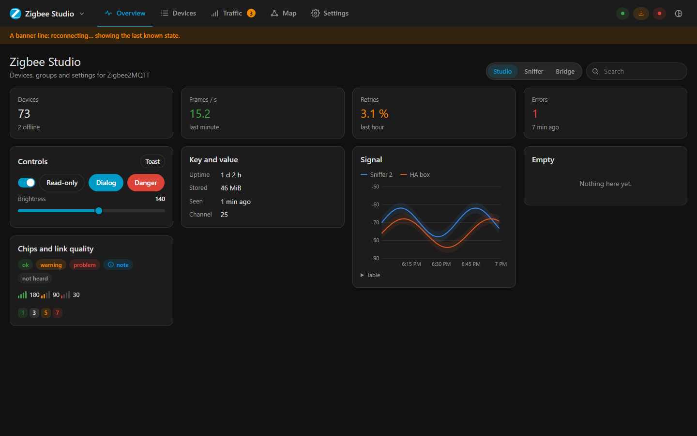

# Zigbee UI

**The shared look of the Zigbee apps.**

Zigbee Studio, Zigbee Sniffer and Zigbee Bridge are separate projects, but they should feel like one
app: the same logo, the same layout, the same buttons and charts, and the same plain words. This kit
is where that look lives. Each app copies it in, so a change here reaches all three.



| App | What it is |
| --- | --- |
| [Zigbee Studio](https://github.com/home-controls/zigbee-studio) | Home Assistant add-on: a fast, live page for Zigbee2MQTT |
| [Zigbee Sniffer](https://github.com/home-controls/zigbee-sniffer) | Home Assistant add-on + ESP32 firmware: listen to your Zigbee network |
| [Zigbee Bridge](https://github.com/home-controls/zigbee-bridge) | ESP32-P4 firmware: your Zigbee coordinator on Ethernet, with its own dashboard |

You only need this repository if you work on one of the apps' pages. It's built with Preact,
`@preact/signals` and plain CSS custom properties, and has no build of its own: each app copies
`src/` into its `web/src/kit/` and bundles it with its own page.

## The design language

- **Logo.** Every app shows the same mark: the blue Zigbee logo (`src/assets/zigbee-logo.png`) next to the app's own name. Use `<Logo />`,
  never a redrawn copy.
- **Layout** (`<Shell>`): logo + name on the left (a menu to the other apps when the app knows where
  they are), page tabs on top with an icon and a word (icons only when narrow; a bottom bar on a
  phone), status pills and buttons on the right, one banner line for connection trouble, then the page.
- **Colour.** Tokens in `tokens.css`: `--bg --surface --text --muted --accent --border` plus the
  states `--ok --warn --bad --info` and `--on` (a light that is on). Defaults are Home Assistant's
  default theme. Inside HA an add-on takes HA's theme from the parent page (`followHomeAssistant`),
  so it matches whatever theme the user runs; elsewhere the viewer picks Auto / Dark / Light.
  Everything else is mixed from the tokens (`--surface-2`, `--accent-soft`, ...). Charts use
  `--series-1..3`, coverage maps `--heat-0..4`, each with its own dark-mode steps.
- **Type.** Roboto (from HA inside HA, `fonts-ha.css`), else the system UI font. 14 px body, 500 for
  headings and labels, tabular numbers for anything that changes.
- **Shapes.** Cards with a 12 px radius and a hairline border, masonry columns of cards, pill-shaped
  buttons and segmented controls, round icon buttons.
- **Read-only shows values.** While an app may only look (`readOnly`), toggles and sliders turn into
  values and quiet bars, never controls that do nothing.
- **Asking first.** `confirmIt()` / `ask()` in-page dialogs, never the browser's own. Destructive
  ones say what will happen and can require the name to be typed.
- **Words.** Plain, short, the same everywhere: "just now", "5 min ago", "2 h 10 min", `—` for no value.

## Files

| File | What |
| --- | --- |
| `tokens.css` | Colour and type tokens, light and dark |
| `base.css` | Components: shell, tabs, pills, cards, buttons, forms, tables, dialog, toasts, charts |
| `zigbee.css` | Zigbee views: link quality, link costs, frames, routes, the mesh map, floor plans |
| `fonts-ha.css` | Roboto from Home Assistant (add-ons only) |
| `shell.tsx` | `Shell`, `Brand` + app switcher, `Pill`, `Splash`, `ThemeButton`, `APPS` |
| `ui.tsx` | `Card`, `Stat`, `Chip`, `Lqi`, `Seg`, `KV`, `Search`, `Ext`, `Toggle`, `Slider`, `readOnly` |
| `chart.tsx` | Hand-drawn SVG `LineChart` / `StackChart` with crosshair, tooltip and a table view |
| `dialog.tsx` | `ask`, `confirmIt`, `<Dialog />` |
| `family.ts` | `useFamily` (where the other apps are, found through Home Assistant), `panelHref` |
| `toast.tsx` | `toast()`, `<Toasts />` |
| `theme.ts` | `initTheme`, `followHomeAssistant`, `themeChoice` |
| `route.ts` | Hash routing: `route`, `href`, `go`, `setDefaultPage` |
| `format.ts` | `ago`, `clock`, `dayClock`, `duration`, `bytes`, `hex`, `nowS`, `setClockSkew` |
| `icons.tsx` | `Icon` (one stroke set for all apps) and `Logo` |

## Using it in an app

From an app's folder, with this repo checked out next to it:

```
node ../zigbee-ui/tools/sync.mjs web/src/kit
```

This copies `src/` to the app's `web/src/kit/`, with `KIT.json` (kit version + a SHA-256 per file)
and `check.mjs`. The app's build runs `node src/kit/check.mjs` first, which fails if a copied file
was edited by hand: change the kit here, bump `VERSION`, then sync every app.

An app imports the CSS in this order: `kit/tokens.css`, (`kit/fonts-ha.css`), `kit/base.css`,
(`kit/zigbee.css`), then its own stylesheet.

## Gallery

`npm ci`, then `npm run dev` and open http://localhost:5175/ for every piece on one page, under
each app's name. `npm run check` type-checks the kit.

`tools/screenshots.py` takes the README screenshots with headless Chrome (dark, 1440 x 900, a fresh
profile per page). Point it at a simulator or a mock, never at a real home: the pictures end up public.

## License

MIT (see `LICENSE`). Zigbee and the Zigbee logo are trademarks of the Connectivity Standards Alliance;
these projects are not affiliated with or endorsed by it.
